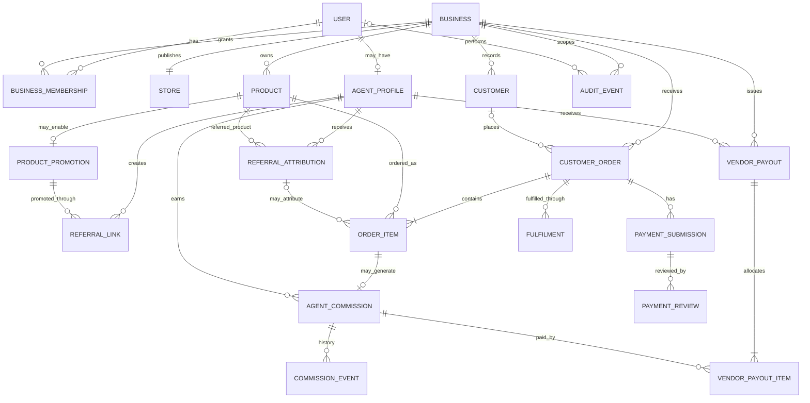

# KamerBiz domain model

**Status:** Proposed technical design based on accepted product decisions  
**Scope:** First release, with the global multi-vendor agent network designed in from the beginning

## 1. Design goals

The domain model must support:

- A public store that accepts direct orders without referral links.
- One vendor per checkout/order in the first release.
- A global agent account that can promote eligible products from many vendors.
- Reusable referral links that can be used by many customers.
- A 30-day attribution window for repeat purchases, subject to the attribution scope and browser/device limitations below.
- Commission calculation and audit history per order item.
- Vendor-controlled payment verification, fulfilment and agent payouts.
- Strict separation of each vendor's private business data.

The agent network is an additional acquisition channel. It is not a prerequisite for creating a store, publishing products or receiving direct orders.

## 2. Main domain concepts

| Concept              | Responsibility                                                                                              |
| -------------------- | ----------------------------------------------------------------------------------------------------------- |
| User                 | Global login identity. A person may be a vendor, an agent, or both.                                         |
| Business             | A vendor's tenant and commercial identity.                                                                  |
| Business membership  | Connects users to a business and grants vendor-side roles such as owner or staff.                           |
| Store                | Public storefront settings and public URL for a business.                                                   |
| Product              | A vendor-owned item with price, description, status and stock.                                              |
| Product promotion    | Vendor-controlled decision to make a product available to agents, including current commission terms.       |
| Agent profile        | Global agent identity linked to a user; never owned by a vendor.                                            |
| Referral link        | Reusable, opaque link created by an agent for an eligible product promotion.                                |
| Referral attribution | Server-side record of a valid agent referral for a browser/customer and product, with a 30-day expiry.      |
| Customer             | A business-scoped customer record. Guest checkout is supported; a customer account is not required.         |
| Order                | A checkout belonging to exactly one business in the first release.                                          |
| Order item           | A product and quantity within an order. Optional agent attribution and commission snapshot are stored here. |
| Payment submission   | Customer-provided transaction reference and optional private evidence.                                      |
| Payment review       | Vendor's recorded decision after checking its actual payment account.                                       |
| Fulfilment           | Vendor's preparation, pickup or delivery progress.                                                          |
| Agent commission     | Commission calculation and current state for an attributed order item.                                      |
| Commission event     | Append-only history of commission state changes and adjustments.                                            |
| Vendor payout        | A vendor-recorded external payment to an agent.                                                             |
| Vendor payout item   | Allocates part or all of a payout to specific payable commission records.                                   |
| Audit event          | Records important security, order, payment, attribution and financial actions.                              |

## 3. Entity relationship diagram

The diagram is conceptual. It shows the main relationships, not every column or database constraint.

## 4. Key relationship and ownership rules

### Users, vendors and agents

- `user` is the global identity and authentication record.
- A user can have memberships in one or more businesses, subject to the product's account policy.
- A user can also have one global `agent_profile`.
- A person who is both a vendor and an agent uses one login; permissions are evaluated for the active business context or agent context.
- Never create a separate agent account underneath each vendor.

### Vendor tenancy

- Every private vendor-owned record carries `business_id` directly or is reachable through a parent record with a database-enforced business relationship.
- A product belongs to exactly one business.
- A customer record is scoped to a business. The same person may appear as a customer of more than one business.
- A customer does not need a KamerBiz login to place an order.
- The backend derives business access from the authenticated user's membership. It must not trust a client-supplied `business_id` as proof of access.

### One vendor per order

- Every order has exactly one `business_id`.
- Every order item must reference a product owned by that same business.
- The first-release checkout operates on one vendor at a time. A cart containing products from several vendors must be separated into vendor-specific carts/checkouts; it must not create a mixed-vendor order.
- The database should enforce the order/product business match with composite keys or an equivalent constraint, not only frontend validation.
- This does not prevent the same customer from placing separate orders with several vendors.

## 5. Referral attribution rules

### Accepted product rules

1. Referral links are reusable and may generate eligible sales for multiple customers.
2. A valid referral click creates or refreshes server-side attribution; a click alone never earns commission.
3. The attribution window is 30 days from the valid referral click.
4. A customer can return and buy again within that window without clicking the link again.
5. The latest valid agent referral wins when multiple agents refer the same product for the same browser/customer context.
6. A direct visit does not erase an unexpired valid referral.
7. A direct order with no valid attribution remains a direct sale and generates no agent commission.
8. Attribution is copied onto the relevant order item at checkout. Historical order items must not change when a referral link or promotion is later disabled.

### First-release technical behaviour

- Referral tokens must be cryptographically random, opaque and unguessable. Never expose sequential database IDs or accept agent, vendor, product or commission values from query parameters as authoritative.
- Resolve the token on the server and validate that the link, agent profile and product promotion are eligible for new attribution.
- Store a server-side attribution record and associate it with a signed, opaque first-party browser identifier. Store only a hash of the browser identifier where practical.
- On checkout, the backend resolves the current valid attribution and attaches it to the matching order item. Do not rely on frontend-supplied agent IDs.
- The 30-day window is measured from the latest valid referral click for that product.
- A new valid agent referral for the same product replaces the prior agent attribution for that browser context. A direct visit does not replace it.
- Browser-based attribution is reliably limited to the same browser/device unless the customer is authenticated and a safe account-linking policy is later implemented. Clearing cookies, private browsing or switching devices may lose attribution. Do not promise cross-device attribution in the first release.

### Attribution scope still requiring product confirmation

The current safe default for the first release is **product-specific attribution**: a link for Product A attributes eligible purchases of Product A, including repeat purchases of Product A within 30 days. It does not automatically award commission on every other product from the same vendor. Whether a referral should apply to other eligible products from the same vendor remains an open product decision and is listed in `docs/06-decisions/open-questions.md`.

### Promotion disabled after a referral

Disabling promotion must stop new referrals. Existing valid attribution records and order-item attributions must remain intact. The precise treatment of an unexpired attribution after the vendor disables promotion should follow the existing customer promise; the initial technical recommendation is to honour an attribution already recorded until its expiry.

## 6. Order, payment and fulfilment rules

- Orders can be direct or agent-attributed; `agent_id` and `referral_attribution_id` are optional at order-item level.
- Guest checkout stores customer contact and delivery/pickup details as order snapshots so later customer profile edits do not rewrite historical orders.
- Order, payment and fulfilment have separate lifecycles.
- Payment evidence is private. A screenshot or transaction reference is a submission, not proof of payment.
- Only an authorised vendor user can confirm payment after checking the vendor's actual account.
- The platform records reviewer, timestamp and decision.
- Fulfilment is performed by the vendor. KamerBiz does not take responsibility for delivery in the initial release.
- Item-level fulfilment progress is recommended so partial fulfilment can be represented without incorrectly making every item commission-eligible.

## 7. Commission rules

- Commission is optional and exists only when an order item has valid referral attribution and a commissionable promotion snapshot.
- Calculate and record commission per order item. For quantity greater than one, the calculation must account for the eligible quantity.
- Snapshot agent, vendor, product, currency, commission type, rate/amount, calculation basis, policy version and calculated amount at attribution/order time.
- Vendor changes to future commission terms must not rewrite an existing attributed order item or commission record.
- Commission is pending until payment is confirmed and the relevant item is fulfilled/completed under the agreed policy.
- A vendor payout is an external payment recorded in KamerBiz; KamerBiz does not hold funds or execute payouts in the first release.
- Do not delete or overwrite financial history. Record state transitions and corrections as append-only commission events or adjustments.
- Partial refunds/returns must adjust only the affected item or commission portion where applicable.

The exact commission basis (discount treatment, delivery fees, taxes and quantity adjustments) remains open and must be settled before implementing the calculator.

## 8. Security and integrity constraints

- Use backend authorization for every vendor operation and scope all queries by `business_id`.
- Use composite unique keys and foreign keys to prevent cross-business product/order relationships.
- Use high-entropy referral tokens; rate-limit resolution and link creation.
- Keep referral attribution server-side; clients cannot set their own agent attribution or commission amount.
- Store payment evidence in private object storage and issue short-lived access links only to authorised vendor users.
- Use append-only audit/commission events for financial and privileged changes.
- Avoid exposing customer phone numbers, delivery addresses or payment evidence to agents. Agent views should show only the minimum order and commission details needed to explain their earnings.
- Never store Mobile Money PINs, bank credentials or customer payment passwords.

## 9. Questions deliberately not assumed

See `docs/06-decisions/open-questions.md` for decisions still needed, especially attribution scope across products, cross-device behaviour, commission basis, partial returns, and whether attribution is honoured after a promotion is disabled.
